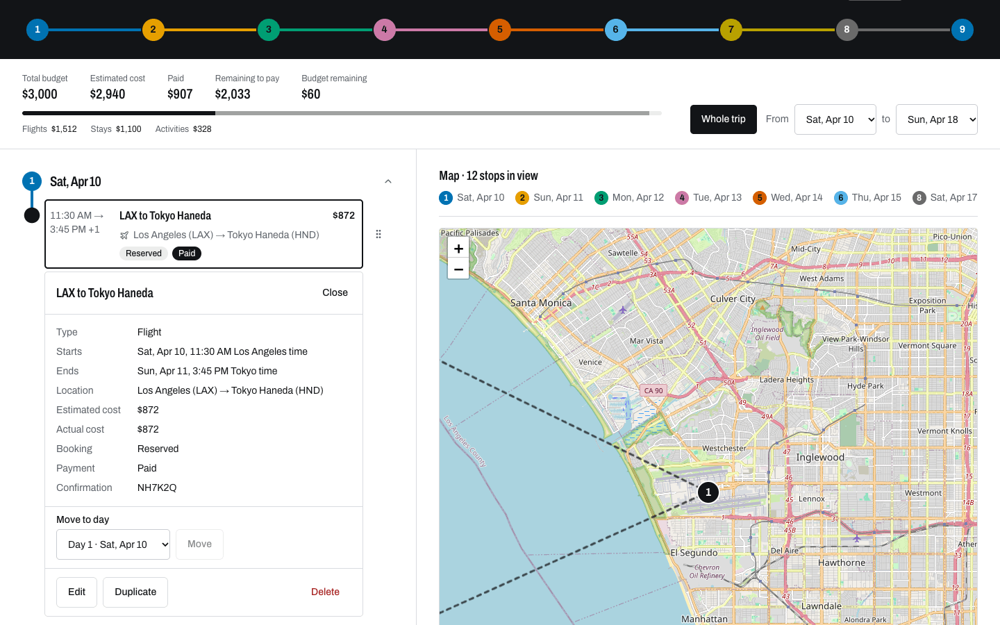
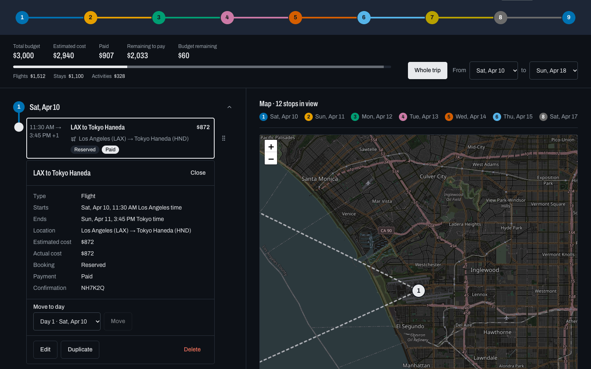
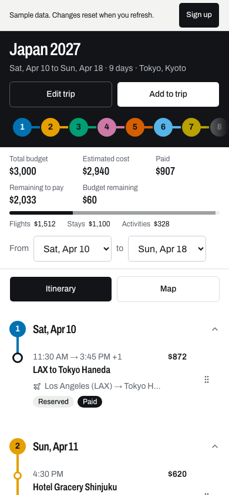
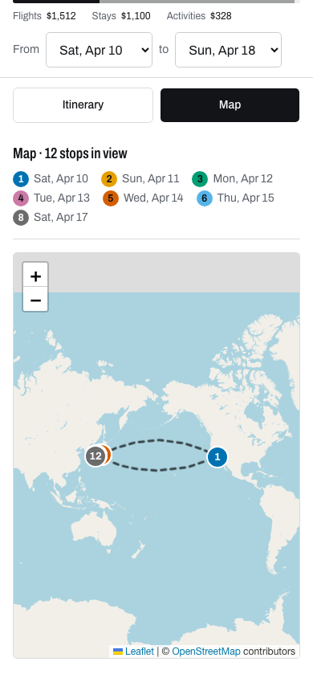
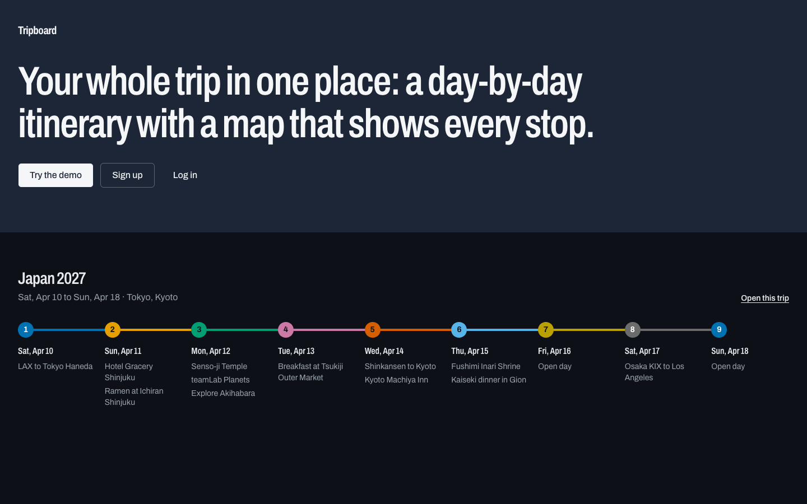

# Tripboard

A travel planner that keeps a whole trip in one place: a day-by-day itinerary, a synced map and a running budget.

**[Live app](https://tripboard-coral.vercel.app)** · **[Try the demo (no sign-up)](https://tripboard-coral.vercel.app/demo)**



## Features

**Itinerary**
- Flights, stays and activities as cards, grouped by day, with booking and payment status
- Add, edit, duplicate and delete items; collapsible days; a date range filter for the whole trip or a slice of it
- Drag and drop within a day or between days, with a "Move to day" control as a non-drag alternative
- Times shown in each place's own time zone (for example a Los Angeles departure and a Tokyo arrival)

**Map**
- Numbered pins and per-day colored routes, with flight arcs between cities
- Selecting an item centers the map on it, and the map follows the active date range

**Budget**
- Total budget, estimated cost, paid, remaining to pay and budget remaining
- Spending by item type, and a text warning when the trip is over budget

**Accounts**
- Email and password sign-up and sign-in on Supabase
- Upcoming and past trip groups; create, edit and delete trips
- Every trip is private to its owner (Row Level Security)
- `/demo` runs the same workspace on a seeded, in-memory trip; changes reset on refresh

**Mobile and accessibility**
- Phone layout with an Itinerary / Map toggle and a bottom sheet for item details
- Touch and keyboard drag, with screen reader announcements
- Follows the system dark mode

## Tech stack

| Area | Choice | Why |
|---|---|---|
| Framework | Next.js 16 (App Router), React 19, TypeScript | Routing, server rendering and typed end to end |
| Styling | Tailwind CSS 4, Base UI primitives | Accessible unstyled components with custom styling |
| Data | Supabase (Postgres, Auth, Row Level Security) | Per-user data with the access rules enforced in the database |
| Client state | TanStack Query | Caching and optimistic updates |
| Forms | React Hook Form, Zod | Schema validation shared with the domain types |
| Drag and drop | dnd-kit | Pointer, touch and keyboard sensors |
| Maps | Leaflet, react-leaflet, MapTiler tiles | Lightweight map with a swappable tile provider |
| Dates | Luxon | Time zone aware times |
| Testing | Vitest, Playwright | Unit and repository tests; browser flows across devices |
| Hosting | Vercel | Deploys from GitHub on every merge to main |

## Engineering highlights

- **One repository interface, two backends.** The UI talks to a `Repository` interface. An in-memory `DemoRepository` powers `/demo`; a `SupabaseRepository` powers accounts. A single contract test runs against both, so they stay interchangeable.
- **Row Level Security.** Authorization lives in Postgres policies, not in app code. `supabase/tests/rls_isolation.sql` checks that one user cannot read or change another user's trips.
- **Optimistic updates with rollback.** Reordering and moving items updates the UI immediately through TanStack Query and restores the previous state if the write fails.
- **Pure, tested logic.** Time zone conversion, budget totals, item ordering and map path building are plain functions in `src/lib/`, with no date, money or ordering math inside components. 173 unit tests cover them.
- **Accessible drag and drop.** Keyboard and touch sensors, custom screen reader announcements for pickup and drop, focus returned to the moved item, and a "Move to day" fallback for anyone who does not drag.
- **Swappable map tiles.** The tile URL and attribution come from environment variables, so the provider can change without a code change.

## Screenshots

**Desktop**

| Light | Dark |
|---|---|
|  |  |

**Phone**

| Itinerary | Map |
|---|---|
|  |  |

**Landing page**



## Testing

```bash
npm test          # Vitest: 173 unit and repository tests
npm run e2e       # Playwright on Chromium (starts the dev server)
npm run e2e:all   # Playwright on every configured project
```

- **Unit tests** cover time zones, budget math, ordering, map paths, form validation and the demo repository.
- **Repository contract** runs against the Supabase repository too when `TEST_USER_EMAIL` and `TEST_USER_PASSWORD` for a dedicated test account are set in `.env.local`. It deletes that account's trips afterwards and is skipped otherwise.
- **End-to-end tests** cover the landing page, the demo workspace, item add/edit/delete, moving items, the map and signed-in account flows.
- **Browser projects:** Chromium, WebKit, iPhone 13, Pixel 7 and a tablet viewport run with `npm run e2e:all`. Firefox is configured as well.

## Run locally

```bash
npm install
cp .env.example .env.local
npm run dev        # http://localhost:3000
```

The demo at `/demo` works without any environment variables. For accounts, set these in `.env.local`:

| Variable | Purpose |
|---|---|
| `NEXT_PUBLIC_SUPABASE_URL` | Supabase project URL |
| `NEXT_PUBLIC_SUPABASE_PUBLISHABLE_KEY` | Supabase publishable key |
| `NEXT_PUBLIC_MAP_TILE_URL` | Optional. Tile URL template, defaults to OpenStreetMap |
| `NEXT_PUBLIC_MAP_ATTRIBUTION` | Optional. Attribution for the tile provider |
| `ANTHROPIC_API_KEY` | Optional, server-only. Turns on "Import booking" for signed-in trips (PDF or screenshot read by Claude, reviewed before anything is added). Unset hides the action. Set a spend limit on the key: there is no per-user rate limit yet |

Scripts:

```bash
npm run dev       # development server
npm run build     # production build
npm start         # serve the production build
npm run lint      # ESLint
npm test          # Vitest
npm run e2e       # Playwright (Chromium)
npx next typegen  # generate route types; run before `tsc --noEmit`
```

The database schema is in `supabase/migrations/`. To check row isolation, paste `supabase/tests/rls_isolation.sql` into the Supabase SQL Editor; it rolls itself back.

## Project structure

```
src/
  app/                 routes: landing, /demo, /login, /signup, /trips, /trips/[tripId]
  components/          trip, itinerary, budget, map, auth, and ui primitives
  lib/
    data/              Repository interface, DemoRepository, SupabaseRepository, query hooks
    time/ budget/ ordering/ map/ items/ trips/   pure, tested logic
    supabase/          browser and server clients
  types/               Zod schemas and inferred types
e2e/                   Playwright tests
supabase/
  migrations/          schema, constraints and Row Level Security
  tests/               RLS isolation check
  seed/                demo trip data
docs/                  product docs and screenshots
```

## Roadmap

- Google sign-in
- Place search
- Import booking PDFs and screenshots into reviewable draft items using AI
- Travel-time and schedule warnings
- Read-only trip sharing
